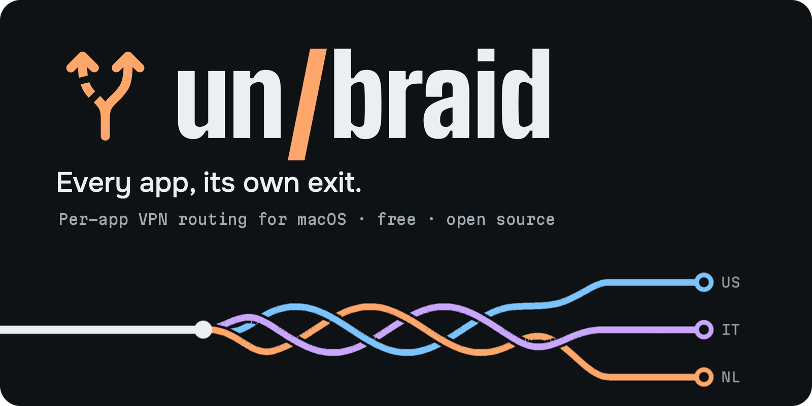
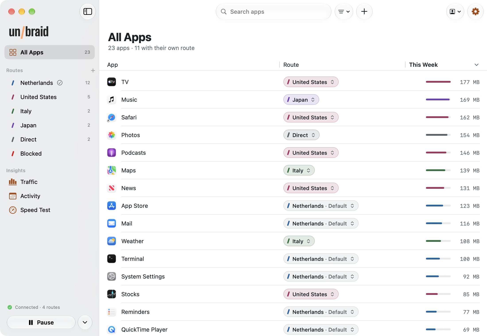
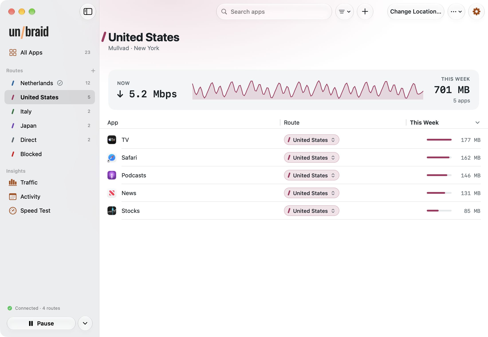
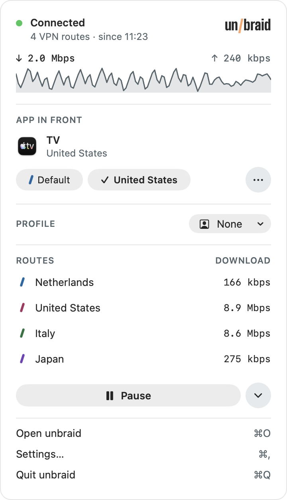
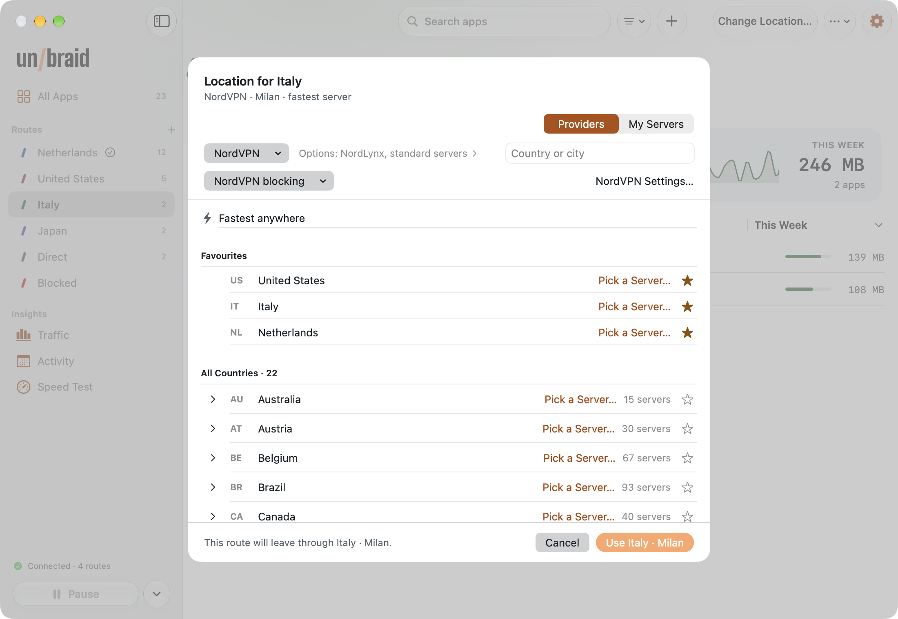
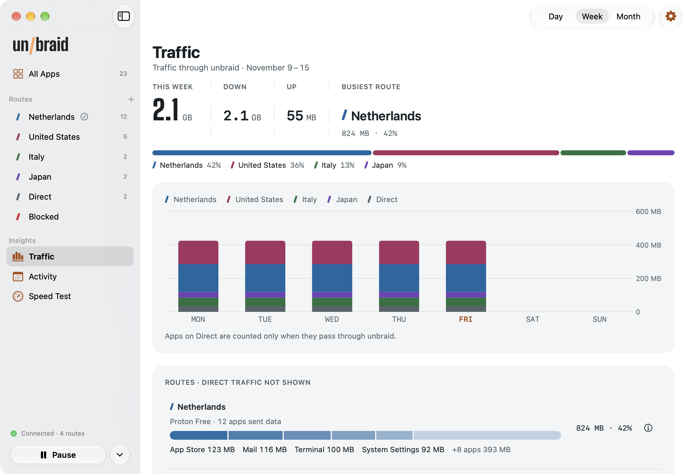

<p align="center">
  
</p>

<p align="center">
  <a href="https://github.com/quiet-crafts/unbraid-mac/releases/latest"></a>
  
  <a href="LICENSE"></a>
  <a href="https://unbraid.app"></a>
  <a href="https://github.com/quiet-crafts/unbraid"></a>
</p>

unbraid is a split tunneling VPN client for the Mac that lets every app take its own exit. Your banking app can skip
the VPN while a streaming app leaves from the US, a second app from Italy and everything else from the Netherlands,
all at the same time. If you use Tailscale, your home network stays reachable too.

<p align="center">
  <a href="https://github.com/quiet-crafts/unbraid-mac/releases/latest"><b>Download the DMG</b></a>
  &nbsp;·&nbsp; <a href="https://github.com/quiet-crafts/unbraid">unbraid for Android</a>
  &nbsp;·&nbsp; <a href="https://unbraid.app">Website</a>
  &nbsp;·&nbsp; <a href="https://unbraid.app/privacy">Privacy policy</a>
  &nbsp;·&nbsp; <a href="https://github.com/quiet-crafts/unbraid-mac/issues">Report a bug</a>
</p>

<table align="center">
  <tr>
    <td align="center" width="38%"><picture><source media="(prefers-color-scheme: dark)" srcset=".github/screenshots/apps-dark.png"></picture></td>
    <td align="center" width="38%"><picture><source media="(prefers-color-scheme: dark)" srcset=".github/screenshots/route-dark.png"></picture></td>
    <td align="center" rowspan="4" width="24%"><picture><source media="(prefers-color-scheme: dark)" srcset=".github/screenshots/panel-dark.png"></picture><br><sub>The app in front, one click from another route</sub></td>
  </tr>
  <tr>
    <td align="center"><sub>Each app gets its own route</sub></td>
    <td align="center"><sub>Every route with its apps and live speed</sub></td>
  </tr>
  <tr>
    <td align="center"><picture><source media="(prefers-color-scheme: dark)" srcset=".github/screenshots/picker-dark.png"></picture></td>
    <td align="center"><picture><source media="(prefers-color-scheme: dark)" srcset=".github/screenshots/traffic-dark.png"></picture></td>
  </tr>
  <tr>
    <td align="center"><sub>Mix providers and countries</sub></td>
    <td align="center"><sub>Data per route and app, by day</sub></td>
  </tr>
</table>

There is also [unbraid for Android](https://github.com/quiet-crafts/unbraid), with the same idea and the same
providers. It needs Android 13 or later.

## Highlights

- Give any app its own exit country or server, let it skip the VPN with Direct, or block its internet access.
  Several exits stay connected at once.
- Use the VPN accounts you already have. One route can go through Mullvad while another uses NordVPN.
- Reach your home network through Tailscale, Headscale or a home WireGuard tunnel, or send chosen apps out through a
  Tailscale exit node.
- Connection checks watch each provider tunnel and, after repeated failures, try another port or server.
- A DNS filter of your choice for VPN routes and Direct traffic, plus the provider's own ad and tracker blocking
  where it has one.
- Saved profiles, a menu bar panel with the front app's route one click away, desktop widgets and Control Center
  controls.
- Stats on this Mac: data per route and app, live speed and connected time, and M-Lab speed tests through one route
  or several at once.
- No ads, no unbraid account and no analytics. Free software under the GPL.

## What it works with

You bring the VPN. unbraid has no servers of its own and works with the accounts and servers you already have.

You can sign in with NordVPN (NordLynx, OpenVPN, Double VPN and Onion over VPN), Mullvad, Private Internet Access,
IVPN, ExpressVPN or AirVPN. For Proton VPN (Free included) and Surfshark you add your WireGuard key once, and for
Windscribe you paste one WireGuard config from their website. After that you choose from the servers your plan
includes. You can also import your own WireGuard or OpenVPN config, paste a Shadowsocks key, or join a Tailscale
tailnet (a self-hosted Headscale works as well).

Routes can mix providers. One app can use Mullvad in Sweden while another uses NordVPN in Japan.

## Getting started

1. Download the DMG from the [releases page](https://github.com/quiet-crafts/unbraid-mac/releases/latest), open it
   and drag unbraid to Applications. Then open unbraid from Applications.
2. macOS asks you to allow unbraid's network extension. Allow it in System Settings › General › Login Items &
   Extensions. unbraid lives in the menu bar; its window opens from there.
3. Accept the terms and choose your VPN. You can sign in to a provider, import a WireGuard or OpenVPN file (*Your own
   server*), paste a Shadowsocks key, or use Tailscale on its own.
4. Select the default route in the sidebar and choose *Change Location…* to pick a country. This is where every app
   goes unless you say otherwise. Then click *Connect* and allow the VPN configuration when macOS asks.
5. To send some apps somewhere else, click *Add Route* and choose another country or server. In *All Apps*, click
   *Show My Apps* (the list stays on your Mac), then drag apps onto a route in the sidebar or use *Move To*. Choose
   *Direct* for apps that should not use the VPN at all, like a banking app.

Each release lists the DMG's SHA-256 checksum and is signed with a Developer ID and notarized by Apple.
[Check the download](#check-the-download) explains how to confirm both before you install.

## Good to know

unbraid is a VPN app, not a VPN service. It has no servers, so you need an account with a supported provider
(the free Proton VPN plan works) or a server of your own.

While unbraid is connected, it is the Mac's VPN. Turn off your provider's own VPN app before you connect unbraid:
running them together can cause routing conflicts.

Your provider's limits still apply. Providers with a connection limit count each route in use as a connection,
while Mullvad counts unbraid as one device. The default route stays connected while unbraid is on. Other routes
connect as soon as an app is assigned to them, even if that app is idle.

The app needs macOS 26 or later, on a Mac with Apple silicon or an Intel processor. It doesn't update itself: to
update, quit unbraid, drag the new version from the DMG over the old one and open it. Your setup stays. macOS may ask
you to allow the updated network extension again. If you say yes to *Check for updates* (asked once, and in
Settings › About), unbraid looks about once a day for a newer version and tells you when one is out.

## Questions

### How is this different from the split tunneling in my VPN app?

In many VPN apps, split tunneling means you can pick apps that skip the VPN, while every other app leaves from the
same place. unbraid lets you choose a route for each app, and those routes can come from different providers.

### Can I use it without a VPN subscription?

Yes. The free Proton VPN plan works, and so does a server of your own. You can import a WireGuard or OpenVPN file,
paste a Shadowsocks key, or use only Tailscale, for example with an exit node at home.

### Can I reach my home network while I use a VPN?

Yes. With Tailscale (plus a subnet router for devices that aren't on your tailnet), or with your router's WireGuard
config added as a home tunnel, apps can reach devices at home and still use their VPN route for everything else.

### Does it have a kill switch?

Yes. In Settings › Protection, *Block traffic outside the VPN* has three levels. *Off*: apps that pick Wi-Fi or
Ethernet themselves can skip the VPN, and while a VPN reconnects any app may use your normal connection. *Internet*:
apps only go out the way you chose for them, so while a VPN reconnects its apps wait instead of using your normal
connection. *Internet and home network*: the same, and blocked apps can't reach devices on your home network either.
Blocking an app turns it on. *Connect on demand* lets macOS bring the tunnel back after sleep, network changes and
restarts. At every level, apps you set to Direct use your normal connection, and nothing is covered while unbraid is
disconnected. unbraid's own requests (signing in to your provider, server lists, and the update check if you turn it
on) also use your normal connection, not the VPN, so your network can see which provider you use.

### Does it get around my provider's device limit?

No. Providers with a connection limit count each route in use against it. Mullvad counts unbraid as one device.

## How it works

unbraid runs a packet tunnel network extension with the [sing-box](https://github.com/SagerNet/sing-box) engine
behind it. The app compiles the configuration, picks servers and watches their health; the extension only runs the
engine.

```
apps -> utun -> sing-box -> rules: DNS, blocked, home, LAN, the app's route, default
                            |- one WireGuard, OpenVPN or Shadowsocks exit per location
                            |- Tailscale (home, exit nodes)
                            '- direct
```

Each TCP and UDP connection is routed by the program that opened it, matched by its path, including helpers inside an
app's bundle. A connection macOS opens on an app's behalf, such as Safari's pages through WebKit or a download
through nsurlsessiond, counts as that app's. DNS is answered with fake addresses and looked up again on the route the
app really uses, so a site sees the country you picked for that app. IPv6 follows an app's route or is refused. Only
the default route and the routes your apps use are connected.

Server lists come from each provider's public API where there is one, and otherwise from
[gluetun-servers](https://github.com/qdm12/gluetun-servers).

## Build

You need macOS 26, Xcode 26, [XcodeGen](https://github.com/yonaskolb/XcodeGen) and Go 1.21 or later (Go fetches the
exact toolchain, 1.26.11, itself through `GOTOOLCHAIN`).

```bash
tools/build-libbox.sh     # Frameworks/Libbox.xcframework from sing-box v1.14.4 with the patches in tools/
xcodegen                  # unbraid.xcodeproj from project.yml
tools/dev-install.sh      # Debug build into /Applications (system extensions run only from there)
xcodebuild -project unbraid.xcodeproj -scheme UnbraidTests -destination 'platform=macOS' CODE_SIGNING_ALLOWED=NO test
```

The build script keeps its work files in `~/Development/unbraid-mac-deps`. Set `WORK` to use another folder. The
patches in `tools/` stop the engine from writing the running configuration, which holds private keys, to disk, match
connections opened for an app by another process to that app, hand the Tailscale node state to the app to be sealed,
refuse files sent through Taildrop, give an OpenVPN tunnel a resolver inside it when its server pushes none, and let
the app's connection checks look up their servers through the tunnel being checked. They also put the network's IPv4
DNS servers first, narrow how UDP traffic is matched to its app, keep a test or Tailscale sign-out that overlaps a
reload from stopping the engine, bound OpenVPN's exit notifications and take security fixes of some dependencies (the
full list: `tools/notices/changes-sing-box.txt`). `tools/build-cli.sh` builds the engine's command-line version, which
the tests use to check every generated configuration.

Running the app takes an Apple Developer Program membership, because the network extension needs a signing team with
that capability. Put your own team ID and bundle-ID prefix in `Config/Local.xcconfig` (git ignores it), as
`Config/Signing.xcconfig` describes. `tools/release.sh` builds a release: the tests, the source archive, Developer ID
signing, notarization and the DMG.

## Privacy

We add no advertising or analytics. You don't need an unbraid account. Your provider credentials are sealed with a key
kept in the Keychain and are only sent to the service they belong to. The list of installed apps is read on the Mac so
you can assign routes, and it never leaves the Mac. Statistics are off until you turn them on and stay on the Mac. The
update check is off until you say yes; when on, it asks unbraid.app for the newest version number and sends nothing
else, so the site sees only your IP address, like any visit. unbraid's own requests to your providers and to
unbraid.app use your normal connection, not the VPN. The privacy policy, with every service the app talks to, is at
[unbraid.app/privacy](https://unbraid.app/privacy).

To report a security problem, see [SECURITY.md](SECURITY.md).

## Check the download

Download the DMG and `SHA256SUMS` from the release into the same folder. From that folder, run:

```sh
shasum -a 256 -c SHA256SUMS
```

The line for the DMG should end in `OK`. The DMG is signed with the Developer ID of team `28PLDKCR52` and notarized by
Apple. To check, run `spctl --assess --type open --context context:primary-signature -v` with the DMG's name; it should
print `accepted` and `source=Notarized Developer ID`.

## Support the project

unbraid is free and has no paid features. If it is useful to you, see
[unbraid.app/donate](https://unbraid.app/donate/) for ways to support it. A donation doesn't unlock anything.

Bug reports are welcome in the [issue tracker](https://github.com/quiet-crafts/unbraid-mac/issues). The project
doesn't take pull requests. [CONTRIBUTING.md](CONTRIBUTING.md) explains why and how else you can help.

## Licence

unbraid is free software under the GNU General Public License, version 3 or (at your option) any later version.
See [LICENSE](LICENSE). sing-box, which unbraid is built on, is under the GPL as well.

unbraid includes or downloads work by other people under their own licences. [THIRD-PARTY.md](THIRD-PARTY.md)
lists them, and the full texts ship inside the app (`Resources/notices.txt`, generated by `tools/notices.sh` from the
Go modules that are actually linked). Each release publishes its complete source next to the DMG.

unbraid is an independent project and isn't affiliated with or endorsed by the VPN providers named here,
Tailscale or SagerNet. Product names belong to their owners.

## About this repository

unbraid is published by Quiet Crafts. Parts of the code and of the text in this repository were written with the
help of AI tools. The developer reviews and tests every change before it is released.
